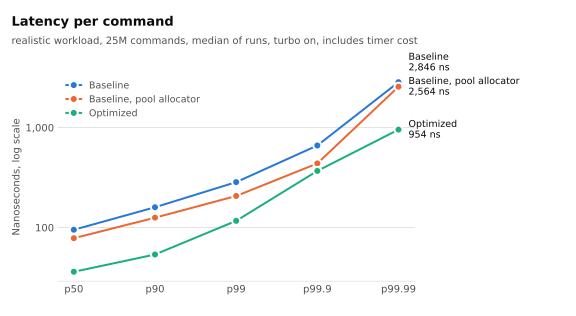
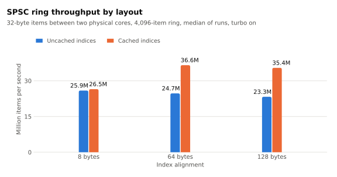

# NanoMatch

A deterministic limit order book and matching engine in C++20, built for low, predictable latency and for
reproducible measurement.

- **Price-time priority matching** for limit, market, cancel and modify commands, to a [written specification](docs/SPEC.md).
- **No heap allocation while matching**, proven by a test that hooks the C allocator for the whole process.
- **Byte-identical output.** The same input gives the same event log on every book, compiler, build type and threading
  mode, which is checked by hash in CI.
- **A wait-free SPSC ring** that carries commands between cores.
- **Measurement you can check.** Every number traces to a raw file recording the commit, flags, machine settings and
  workload behind it, and the workloads were committed before anything was measured.

## Results

Generated from the files in [`results/`](results), on a laptop rather than an isolated server. The workload model, method
and limitations are in [docs/BENCHMARKS.md](docs/BENCHMARKS.md), which has the full tables.

<!-- summary:start -->
Latency per command on the primary `realistic` workload, 25M commands, in nanoseconds. Average comes from
untimed runs, and percentiles from timed runs that include the timer's own cost.

| Book | Turbo | Average | p50 | p99 | p99.9 | p99.99 | L1d misses per command |
|---|---|---|---|---|---|---|---|
| baseline | on | 86.3 | 95 | 284 | 661 | 2846 | 5.39 |
| baseline_pool | on | 68.6 | 78 | 207 | 438 | 2564 | 5.17 |
| fast | on | 24.9 | 36 | 117 | 368 | 954 | 2.19 |
| baseline | off | 164.6 | 200 | 524 | 799 | 8718 | 5.39 |
| baseline_pool | off | 125.0 | 164 | 410 | 583 | 4102 | 5.17 |
| fast | off | 45.0 | 77 | 159 | 242 | 483 | 2.19 |

| Other measures, turbo on | Result |
|---|---|
| Ring throughput, 32-byte items between two cores, median | 36.6M items/s |
| Gateway to book throughput across the ring, median | 20.1M commands/s |
| Gateway to book latency, one command at a time, p50 / p99.9 | 202 / 333 ns |
| Timer cost, p50 | 10.8 ns |
| Spread of one command's latency across replays, stddev, p50 | 3.7 ns |
| Spread of a whole replay's average across replays, stddev | 0.12 ns |
<!-- summary:end -->

<picture>
  <source media="(prefers-color-scheme: dark)" srcset="docs/plots/latency_dark.svg">
  
</picture>

<picture>
  <source media="(prefers-color-scheme: dark)" srcset="docs/plots/ring_dark.svg">
  
</picture>

## Design

```
commands --> [gateway thread] --SPSC ring--> [engine thread: OrderBook] --> events
                                                      |
                     +-------------------+------------+-------+-------------------+
                     |                   |                    |                   |
                 OrderPool          PriceLadder           LevelBitmap          IdIndex
                 fixed nodes,       one array,            next occupied        open addressing,
                 index links,       O(1) by price,        level in a few       8-byte slots,
                 LIFO free list     head/tail/total       word accesses        backward-shift erase
```

| Component | Choice | Reason |
|---|---|---|
| [`OrderPool`](include/nanomatch/order_pool.hpp) | Fixed array of 32-byte nodes linked by 32-bit index | No allocator on the hot path. Two nodes fit a cache line, and none straddles one. The most recently freed node is reused first, since it's likely to be cached |
| [`OrderBook`](include/nanomatch/order_book.hpp) | One dense array of price levels | A price only ever holds one side between commands, so both sides can share one array with O(1) access |
| [`LevelBitmap`](include/nanomatch/level_bitmap.hpp) | Layers of 64-bit words, each summarizing the layer below | Finds the next occupied level across a sparse ladder without a long scan |
| [`IdIndex`](include/nanomatch/id_index.hpp) | Linear probing with backward-shift deletion | Short probes on shared cache lines, and no tombstones to slow a long-running book |
| [`SpscRing`](include/nanomatch/spsc_ring.hpp) | Separately aligned indices, each side caching the other's | Limits cache-line traffic between cores. Operations are wait-free |
| [`FixedArray`](include/nanomatch/fixed_array.hpp) | One mapping per array, touched at startup, with huge pages requested | No page faults or allocation while matching |

Decisions, including what was rejected and why, are in the [design log](docs/DESIGN.md).

## How it's tested

The optimized book shares no matching code with [the reference book](src/baseline/baseline_book.hpp), which uses standard
containers. Everything below runs in CI.

- **Differential testing:** both books process the same streams, and every event must match byte for byte.
- **Fuzzing:** libFuzzer drives both books under AddressSanitizer and UndefinedBehaviorSanitizer. It found a real bug that
  every other test had missed, and that input now runs on every fuzz session.
- **Randomized checks against a model** that tracks every queue, so a priority error is caught at the command that caused it.
- **Golden hashes** of event logs, on four book variants, one and two threads, every compiler and build type.
- **ThreadSanitizer** on the ring and pipeline, with a two-thread test checking every item.
- **An independent encoding** of the specification's worked example, in Python, sharing no code with the engine.

Tests were also checked by injecting bugs one at a time. The differential test caught all 16 injected into the optimized
book, and the [design log](docs/DESIGN.md) has the details.

## Building

Requires Linux on x86-64, GCC 13+ or Clang 18+, CMake 3.25+, and Ninja.

```sh
make build test            # release build and tests
make replay-check          # every book and threading mode reproduces the recorded event hashes
make asan                  # tests under AddressSanitizer and UndefinedBehaviorSanitizer
make tsan                  # tests under ThreadSanitizer
make fuzz                  # coverage-guided fuzzing of both books under sanitizers, requires Clang
make coverage              # coverage report in build/coverage/html
make check                 # format, tests, sanitizers and static analysis
make matrix                # every compiler and preset CI covers, from a clean build
```

On recent Linux kernels, ThreadSanitizer may need `sudo sysctl -w vm.mmap_rnd_bits=28`.

## Using the tools

```sh
# Generate a workload, then replay it. Runs that print the same hash produced the same events.
build/release/tools/nm_gen --profile realistic --seed 1 --commands 1000000 --out /tmp/commands.nmc
build/release/tools/nm_replay --in /tmp/commands.nmc --min-price 1 --max-price 1048576 --capacity 20000 \
    --book fast --threads 2 --out /tmp/events.nme
```

To reproduce the benchmarks, see [Reproducing](docs/BENCHMARKS.md#reproducing).

## Repository layout

```
include/nanomatch/   the engine: order book, pool, ladder, bitmap, index, ring, protocol
src/baseline/        reference book using standard containers
src/workload/        seeded synthetic order flow
tests/               unit, model, differential, no-allocation and fuzz tests, and golden hashes
bench/               benchmark programs
tools/               nm_gen and nm_replay
scripts/             machine setup, benchmark runs, report and chart generation
results/             raw benchmark results
docs/                specification, design log and benchmark report
```

## Limitations

- One instrument per book, with no self-trade prevention, IOC or FOK limits, stops, icebergs, auctions, networking or
  recovery. See the [specification](docs/SPEC.md).
- Order IDs must increase strictly, which assumes one sequencing sender.
- Memory is proportional to the width of the price band, whether used or not.
- Results come from a laptop with synthetic order flow, so they say little about any particular production system.

## License

[MIT](LICENSE)
